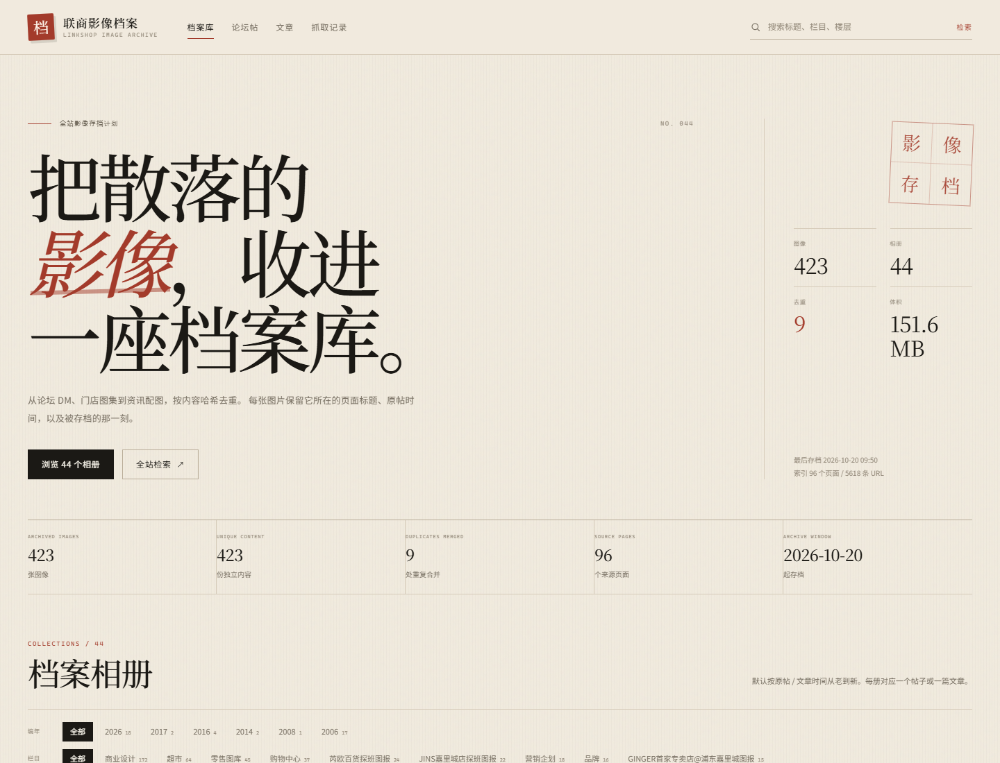
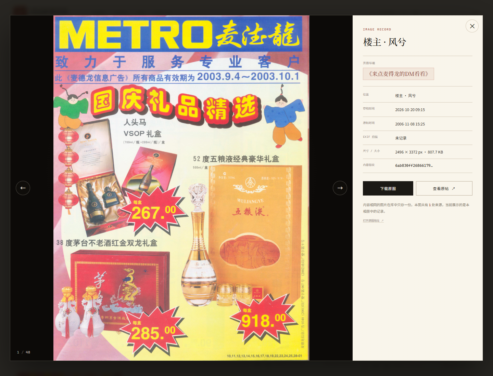

# 联商影像档案

一个面向 **联商网全站** 的 Python 图片存档爬虫，以及配套的档案库相册浏览应用。

它不是只抓一个帖子：从首页、栏目页或任意种子页出发，自动发现全站链接，区分论坛帖与文章，按 **帖子 / 文章** 建立相册；所有图片按 **SHA-256 内容哈希** 去重，并记录图片所在的 **页面标题**、**原帖/文章发布时间**、**入库存档时间**、EXIF 拍摄时间（若有）。

> 适合做个人研究性存档。请遵守原站 robots.txt、控制抓取频率，图片版权归原作者及原网站所有。

---

## 界面预览






---

## 功能

- **全站 BFS 发现**：首页 → 栏目 → 论坛版块 → 帖子 / 文章，链接队列保存在 SQLite，可中断、可续爬。
- **最老优先**：默认从 2006 年的老帖开始；版块先探测真实最后一页，再从最后一页倒着翻，帖子按 URL 年份排序。`--order newest` 可切回发现顺序。
- **两类页面解析**：
  - 论坛帖：兼容经典 `td.main_text` 模板与 2016 年后的 `div.ltzd_body` 模板；
  - 文章：自动识别 `article.page` 等正文容器，提取标题、栏目、作者、发布时间与正文配图。
- **懒加载图片**：优先读取 `data-original` / `data-src`，兼容老帖的占位图。
- **内容去重**：相同图片只落盘一份；不同帖子/文章引用同一张图时，保留全部来源与楼层信息。
- **时间可追溯**：
  - `images.archived_at`：图片首次入库存档时间；
  - `image_sources.archived_at`：该相册/楼层收录它的时间；
  - `images.posted_at`：原帖/文章发布时间；
  - `images.exif_taken_at`：图片 EXIF 拍摄时间（有则记录）；
  - `images.http_last_modified`：图片响应头 `Last-Modified`（有则记录）。
- **档案库 UI**：编年 / 栏目 / 类型筛选、全站检索、相册瀑布流、灯箱查看元数据、单图下载、整册 ZIP 导出（文件名带页面标题）。
- **结构化数据库**：`albums / pages / posts / images / image_sources`，外加 `crawl_urls` 队列与 `site_crawls` 运行记录。
- **礼貌抓取**：遵守 robots.txt，默认 2 秒请求间隔，支持限页、限图、失败重试、断点续爬。

---

## 快速开始

要求 Python 3.10+。

```powershell
git clone git@github.com:silentwinter127-cv2/linkshop-archive.git
cd linkshop-archive

python -m venv .venv
.\.venv\Scripts\Activate.ps1
python -m pip install -r requirements.txt
```

### 1. 抓取

默认就是“最老优先”。先做一次有界试跑：

```powershell
python crawler.py --scope site --max-pages 500
```

如果只想从最老的论坛图楼开始：

```powershell
# 6 个主版块，包含零售图库 boardid=20
python crawler.py --scope forum --max-pages 500
```

想回到“抓到什么算什么”的发现顺序：

```powershell
python crawler.py --scope site --max-pages 500 --order newest
```

确认无误后，抓全站（`0` 表示不限制页面数）：

```powershell
python crawler.py --scope site --max-pages 0
```

只抓论坛或只抓资讯栏目：

```powershell
python crawler.py --scope forum --max-pages 0
python crawler.py --scope news --max-pages 0
```

也可以从指定页面开始：

```powershell
python crawler.py "http://www.linkshop.com/club/archives/2006/313659_3.shtml"
python crawler.py "http://www.linkshop.com/news/2026553038.shtml" --max-images 80
```

> 默认数据目录为 `./data`。全站抓取可能持续数小时，建议先 `--max-pages 500` 看效果，再逐步放开；中断后重新运行同一条命令即可续爬。

### 2. 浏览

```powershell
python app.py --port 5055
```

打开 <http://127.0.0.1:5055>。

> 当前工作区的 `data/` 里已有一批实测数据：44 个有图相册、423 张图、约 151.6 MB，其中 2006 年老帖已收录 172 张。队列中还保留约 5400 条待抓 URL；继续运行 `python crawler.py --scope site --max-pages 0` 会从队列继续，并默认先抓较老的页面。

页面：

| 路径 | 说明 |
| --- | --- |
| `/` | 档案库首页：统计、编年、栏目、相册网格 |
| `/album/<id>` | 相册详情：瀑布流图版、灯箱、分页 |
| `/search?q=` | 按页面标题、栏目、作者、楼层、相册标题检索 |
| `/runs` | 抓取记录与队列状态 |
| `/download/album/<id>` | 导出相册 ZIP（含 `manifest.csv` 与 `README.txt`） |
| `/download/image/<id>` | 下载单张原图 |
| `/media/...` | 原图 / 缩略图 |
| `/healthz` | 健康检查 |

---

## 全站抓取是怎么做的

### 抓取顺序：最老优先

默认 `--order oldest`。队列不是按“发现时间”先进先出，而是按 URL 推算出的历史年份排序：

1. 论坛版块第 1 页只用来读总页数；
2. 联商的 `/250` 可能包含空页（例如零售图库标称 250 页，实际最后一页是 198 页），所以会用二分探测找到**真实最后一页**；
3. 从最后一页往前排：`page=198` 优先级 100，`page=197` 为 200……；
4. 帖子按 URL 中的年份排：2006 年优先级约 431，2007 年 436，……，2026 年 530；
5. 文章排在老帖之后（约 900），普通导航页最后（5000）。

这样即使版块有几千页，也会先翻到最老的分页，再抓 2006/2007 的图楼。每次启动都会对现有 `pending` 队列重新计算优先级，并强制重新读取 6 个主版块的第 1 页（`boardid=20` 零售图库、2、4、1、12、23），确保历史分页被发现。

### 发现范围

默认种子是 `http://www.linkshop.com/`，只跟随同域页面：

- `www.linkshop.com`、`linkshop.com`；
- `www.linkshop.com.cn` / `linkshop.com.cn` 自动归一化为 `.com`（旧链接兼容）；
- 站内图片允许来自 `blog.linkshop.com.cn` 等联商图片站；
- 跳过 `m.linkshop.com`、`soupu.com` 等站外域名。

`--scope` 控制范围：

| 值 | 范围 |
| --- | --- |
| `site`（默认） | 全站所有可抓 HTML 页面 |
| `forum` | 仅 `/club/` 论坛 |
| `news` | 仅资讯、专栏、专访、数据、案例等栏目 |

### 队列与续爬

`crawl_urls` 表保存每个 URL 的状态：

```
pending → in_progress → done
                     ↘ failed
                     ↘ skipped
```

- 启动时会把上次崩溃遗留的 `in_progress` 重置为 `pending`；
- 已完成的页面不会重复抓取；
- `--retry-failed` 把失败页面重新排队；
- 队列与去重都在 SQLite 中，进程退出不会丢。

### 页面分类

1. **论坛帖**：URL 匹配 `/club/archives/YYYY/<id>[_页码].shtml`
   - 首帖建立相册，自动推算/探测后续分页；
   - 每个楼层写入 `posts`，楼层图片写入 `images + image_sources`；
   - 兼容经典模板和新版 `ltzd` 模板。
2. **文章**：`/news/`、`/column/`、`/interview/`、`/data/`、`/pdl/`、`/case/`、`/cnma/`、`/atlas/`，或页面中存在 `article.page` 正文容器
   - 一篇文章 = 一个相册；
   - 正文容器内的图片才纳入，广告、二维码、站点图标会被过滤。
3. **其他页面**：只记录访问并继续发现链接，不建立相册。

### 图片过滤

- 只接受正文容器内的图片（论坛 `td.main_text` / `.ltzd_R_m`，文章正文 section）；
- 过滤头像、签名档、表情、图标、广告；
- 下载后用 Pillow 实际探测尺寸与格式，默认要求：
  - 宽 ≥ 200px
  - 高 ≥ 150px
  - 文件 ≥ 3000 字节
- 过小的装饰图（如文章里的分隔线 `pc_01.png`）会被跳过，不进入相册。

可在命令行调整：`--min-width`、`--min-height`、`--min-bytes`。

### 去重与时间

```
内容字节 → SHA-256 → images.sha256 UNIQUE
                         │
                         └── 同一张图只保存一份文件
image_sources：每一次出现的帖子/楼层/页码/页面标题
```

- 图片文件路径：`data/images/<sha前两位>/<sha>.<ext>`
- 缩略图：`data/thumbs/<sha>.jpg`
- 文件修改时间会设置为入库时间，便于在资源管理器中按时间排序；
- 重复图片在相册中显示 `去重 ×N` 徽标，灯箱里显示总来源数。

**“页面标题”如何标注：**

- `albums.title`：帖子标题 / 文章标题；
- `images.page_title`：首次入库时的页面标题；
- `image_sources.page_title`：该次出现的页面标题（同一张图被不同页面引用时，各相册显示各自标题）；
- UI 每张图卡片底部固定显示 `《页面标题》`；
- ZIP 导出的图片文件名也包含页面标题与楼层，例如：
  `001_来点麦得龙的DM看看_楼主.jpg`。

**“存档时间”如何记录：**

- 抓取下载成功的那一刻写入 `images.archived_at` 与 `image_sources.archived_at`；
- 原帖/文章时间写入 `images.posted_at`、`posts.posted_at`；
- 重复抓取时不会覆盖首次存档时间，只更新 `last_seen_at`；
- 灯箱和卡片都会显示“存档 YYYY-MM-DD HH:MM”。

---

## 数据模型

```text
albums (相册：论坛帖 / 文章)
  ├─ pages (帖子分页；文章只有第 1 页)
  │    └─ posts (论坛楼层；文章使用一个伪楼层 "正文")
  └─ image_sources (图片在相册中的每一次出现)
        └─ images (按 SHA-256 唯一的图片实体)
crawl_urls (全站 URL 队列)
site_crawls (每次抓取会话统计)
```

核心字段：

| 表 | 关键字段 |
| --- | --- |
| `albums` | `kind`（thread/article）、`source_key`、`url`、`title`、`section`、`author`、`source_year`、`posted_at`、`page_count`、`archived_at` |
| `pages` | `album_id`、`page_no`、`url`、`fetched_at` |
| `posts` | `album_id`、`source_id`、`floor`、`author`、`posted_at`、`body_text` |
| `images` | `sha256`、`rel_path`、`thumb_path`、`width`、`height`、`bytes`、`page_title`、`archived_at`、`last_seen_at`、`posted_at`、`exif_taken_at`、`http_last_modified` |
| `image_sources` | `image_id`、`album_id`、`post_id`、`source_url`、`page_title`、`archived_at`、`posted_at`、`position` |
| `crawl_urls` | `url`、`status`、`depth`、`priority`、`attempts`、`album_id` |
| `site_crawls` | 每次运行的页面数、相册数、新图/重复/错误数 |

数据库：`data/archive.db`（SQLite，WAL 模式）。可直接用 Python 查询：

```powershell
python -c "import sqlite3; c=sqlite3.connect('data/archive.db'); print(c.execute('select count(*) from images').fetchone())"
```

---

## 命令行参数

```
python crawler.py [seeds ...] [options]
```

| 参数 | 默认 | 说明 |
| --- | --- | --- |
| `seeds` | 按 scope 选择首页 | 一个或多个种子 URL |
| `--scope` | `site` | `site` / `forum` / `news` |
| `--order` | `oldest` | `oldest` 按年份从老到新；`newest` 按发现顺序 |
| `--data-dir` | `data` | 数据目录（DB、图片、缩略图） |
| `--max-pages` | `1000` | 最多抓取页面数；`0` 为不限 |
| `--max-depth` | `10` | 最大链接深度 |
| `--max-images` | `0` | 最多下载图片数；`0` 为不限 |
| `--delay` | `2.0` | 请求间隔秒数 |
| `--timeout` | `30` | 单请求超时 |
| `--retries` | `3` | 失败重试次数 |
| `--min-width` | `200` | 图片最小宽度 |
| `--min-height` | `150` | 图片最小高度 |
| `--min-bytes` | `3000` | 图片最小字节数 |
| `--retry-failed` | 关闭 | 把 `failed` 页面重新排队 |

示例：夜间慢速全站抓取

```powershell
python crawler.py --scope site --max-pages 0 --delay 2.5
```

---

## 目录结构

```text
linkshop-archive/
├─ crawler.py        # 全站队列、下载、去重、时间记录
├─ parser.py         # 论坛双模板 + 文章正文解析
├─ db.py             # SQLite schema 与查询
├─ app.py            # Flask 档案库
├─ utils.py          # 文件名 / 时间 / 体积格式化
├─ requirements.txt
├─ templates/
│  ├─ base.html
│  ├─ index.html
│  ├─ album.html
│  ├─ search.html
│  ├─ runs.html
│  ├─ 404.html
│  └─ _macros.html
├─ static/
│  ├─ style.css
│  ├─ app.js
│  └─ favicon.svg
├─ tests/
└─ data/             # 运行后生成
   ├─ archive.db
   ├─ images/
   └─ thumbs/
```

---

## 测试

```powershell
python -m unittest discover -s tests -v
```

覆盖：

- 经典 / 旧版论坛模板解析、懒加载图片、签名档过滤；
- 文章容器、栏目、作者、时间、广告图过滤；
- URL 归一化、分页地址、blocked 规则、scope；
- SHA-256 去重、多来源记录、存档时间、队列生命周期；
- 文件名 / 时间 / 体积格式化。

---

## 已知边界

- **不执行 JavaScript**：依赖 JS 渲染后才出现的图片/链接不会被发现；当前联商页面以静态 HTML 为主。
- **登录/验证码页面不抓**：`/members/`、后台、登录、发帖、搜索等路径会跳过。
- **图片域名白名单**：默认允许联商主站与 `blog.linkshop.com.cn` 等；若以后出现新的图床，在 `parser.py` 的 `IMAGE_HOST_SUFFIXES` 或 `_image_host_ok` 中扩展。
- **全站抓取的体量**：站点页面较多，建议先 `--max-pages 500`；限页/限图后再次运行会继续队列，不会从头开始。
- **版权**：本项目只提供抓取与整理工具，不改变图片版权归属；请勿将存档用于侵权传播。

---

## 备注

- 页面编码：老站声明 `gb2312`，实际常用 `gb18030`；解析器已做编码兼容。
- 图片大小：2006 年的 DM 扫描图可能单张 1–3 MB，全站抓取前请预留磁盘空间。
- 如果只想抓最初的目标帖子：

```powershell
python crawler.py "http://www.linkshop.com/club/archives/2006/313659_3.shtml" --max-pages 5
```
